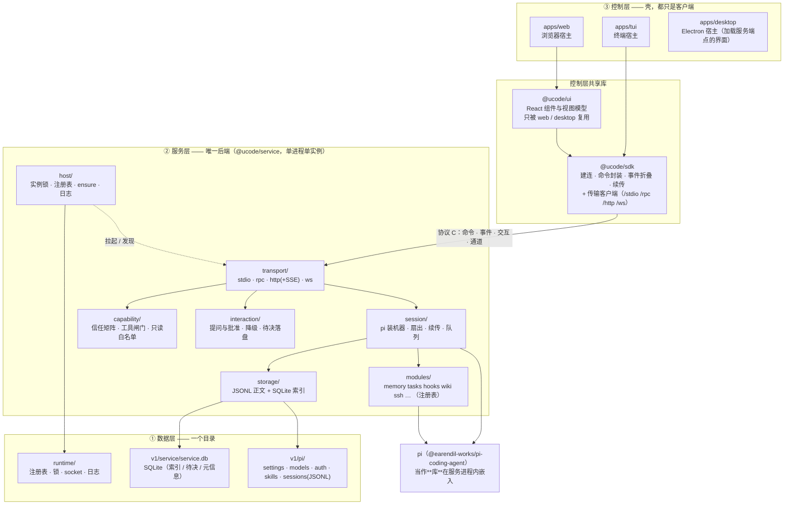
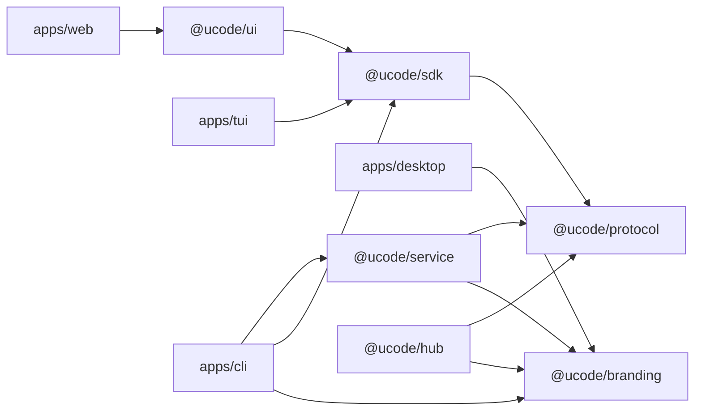
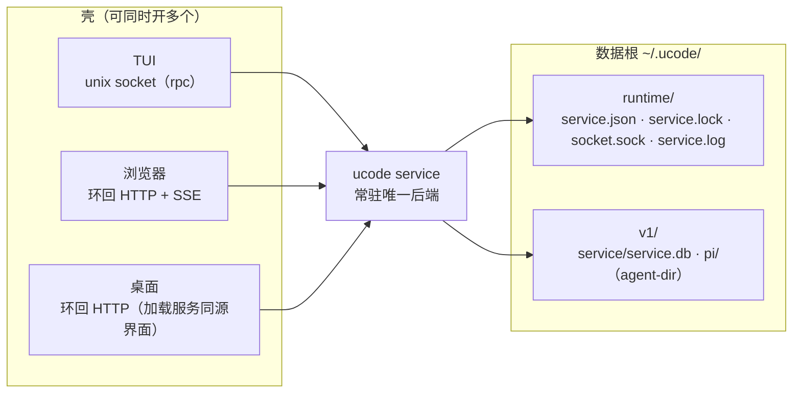
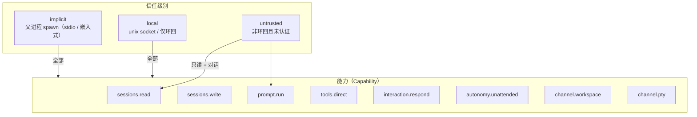

# 01 · 架构总览图

包、协议与运行形态的分层与通路。本文是**视觉索引**：把散在 [01 实现设计](01-实现设计.md)、
[02 服务层内部](02-服务层内部.md) 与各包 `README.md` 里的关系画在一起。

**权威来源仍是代码与配置**：依赖边的唯一事实来源是 [`tools/boundaries.json`](../tools/boundaries.json)，
磁盘布局的唯一事实来源是 `packages/service/src/paths.ts`。本文与它们冲突时以它们为准。

## 一、主图：三层与一个协议

**协议 C 划在"服务层进程"这一条边界上**——它是控制层唯一能看到的东西。传输不再是独立一层：
服务端的四种传输在 `service/src/transport/`，客户端那一半在 `sdk/src/transports/`，
两侧只共享 `protocol` 里的消息 schema。

**读法**：壳只认识 `sdk`；`sdk` 只认识协议 C；协议 C 的对端是 `transport/`；再往里才是服务层的
各个子系统。**没有任何一条边从服务层指回壳**。

## 二、依赖方向（谁可以 import 谁）

四条硬边界（门禁 + 反向验收一起守）：

1. **壳不依赖 `@ucode/service`**——反向验收解析生产依赖树，出现即失败；
2. **`protocol` 是叶子**：任何包都不许反向依赖它；
3. **`sdk` 保持 headless**：不 import ui、不假设 DOM（TUI 才能只复用 sdk）；
4. **服务端传输与客户端传输分居两包**：`service/src/transport/` ↔ `sdk/src/transports/`，
   共享的只有 `protocol` 的消息 schema。

## 三、运行形态（一个数据根 = 一个服务 = N 个壳）

- 壳启动时 `ensureService`：**发现 → 连上，没有就拉起**（注册表 + pid + 端点探测三重确认）；
- 一个数据根只有一个服务（实例锁 + SQLite 写锁）；其余进程只能是客户端；
- 桌面壳同样走"确保共享服务"，窗口加载的界面**由服务同源发出**（与浏览器里是同一份产物）；
  `service start --foreground --stdio` 是给"父进程 spawn 的嵌入式壳"准备的形态（不写注册表、
  不占锁、不开端口），当前没有常驻壳用它。

## 四、信任级别（谁被授予了什么）

信任级别**由传输声明，不由客户端自报**；能力按面拆分，服务端按信任矩阵回告实际授予的集合。

第二条权限轴是**自主级别**（`confirm` / `auto-edit` / `plan` / `full-access`）：`auto-edit` 与
`full-access` 需要"本机等价或已认证且有授权"的通路；`plan` 与目标模式互斥。
两条轴的判定都在 `capability/` 里，且都记录成会话里的审计记录。
