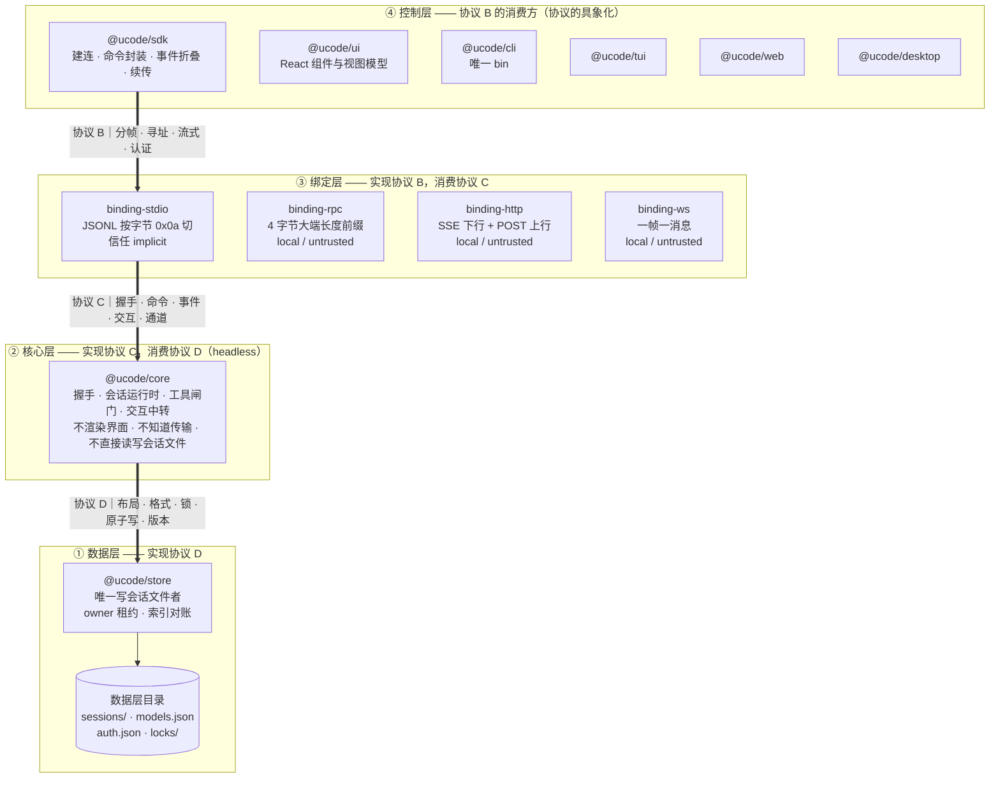
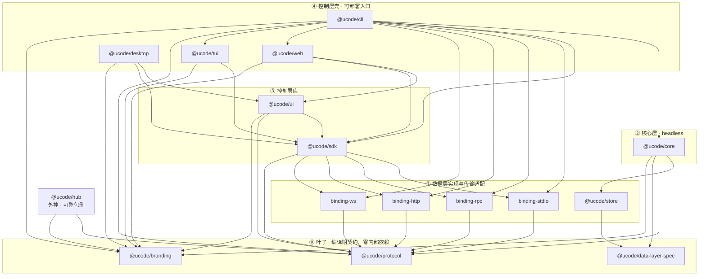
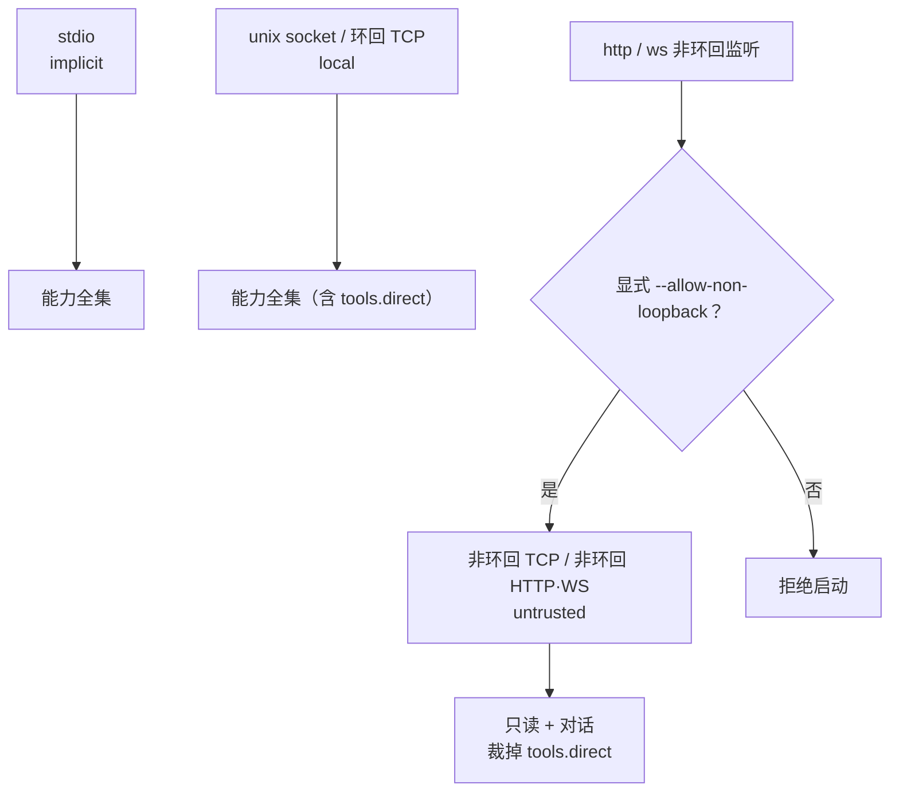

# 01 · 架构总览图

包、协议与基础架构的分层与通路。本文是**视觉索引**：把散在 [spec §1 分层](../../spec/01-架构.md)、[spec §7 包结构](../../spec/01-架构.md)、[§三 依赖图](00-实现设计.md) 里的关系画在一起。

**主图是「四层与三协议」**（§一）；§三、§四 是与之**正交**的两个补充视角——前者画依赖方向（谁可以 import 谁），后者画信任级别（谁被授予了什么），三张图回答的是不同问题，不互为重复。

**权威来源仍是代码与配置**：依赖边的唯一事实来源是 [`tools/boundaries.json`](../../tools/boundaries.json)（允许列表），协议语义见 spec，实现见各包 `README.md`。本文与它们冲突时以它们为准。

## 一、主图：四层与三协议

协议就是层与层之间的边界——协议 B 划在"每种绑定的对端"，协议 C 划在"核心层进程"，协议 D 划在"数据层目录"。



### 读法

- **协议是边界，不是层。** 三条粗箭头画在层与层之间。层是部署形态，协议是接口约定。
- **每层的协议都由本层实现、被上一层消费。** 数据层实现 D（`store`），核心层只消费；核心层实现 C（`CoreServer` 接口），绑定层只消费；绑定层实现 B（`createBinding` 服务端 + `./client` 客户端），控制层只消费。这条对称性是"三协议独立演进"能成立的原因——换掉数据层实现不影响协议 C，新增一种绑定不影响协议 D。
- **控制层没有自己的协议。** 它是协议 B 的具象化；图中把它连到 `sdk`，因为 `ui` 与各壳的传输都经 `sdk` 的传输子路径（`@ucode/sdk/http` 等，内部再导出绑定包的 client）。
- **三个叶子包不在任何层里**（编译期契约，跨层共享）：`@ucode/protocol` 是协议 C 的消息 schema 加 `CoreServer` 接口，`@ucode/data-layer-spec` 是协议 D 的规范与一致性套件，`@ucode/branding` 是品牌参数。它们不引入运行期边界，所以在四层图里刻意不占位置。见 [§三 依赖方向](#三依赖方向编译期)。
- **`uhub` 不属于任何一层**，是外挂：作为能力提供者走工具接入机制，作为通路提供者提供中继；它不实现 agent loop，也不持有会话数据。

## 二、基础设施落在哪一层

各包的**运行期外部依赖**（来自各自 `package.json`）：

| 层 | 包 | 运行期外部依赖 |
|---|---|---|
| ④ 控制层 | `@ucode/ui` | `react` · `zustand` · `react-markdown` + `remark-gfm` + `rehype-highlight` + `highlight.js` · `@xterm/xterm` + `@xterm/addon-fit` |
| ④ 控制层 | `@ucode/web` / `@ucode/desktop` | `react` · `react-dom`（构建期 `vite` / `@vitejs/plugin-react` / `@tailwindcss/vite` / `esbuild` / `electron` / `electron-builder`） |
| ④ 控制层 | `@ucode/tui` | `@earendil-works/pi-tui`（基座的终端组件层） |
| ④ 控制层 | `@ucode/sdk` / `@ucode/cli` | **无**——依赖全部落在工作区内，传输由壳注入 |
| ③ 绑定层 | `@ucode/binding-http` | `hono` · `@hono/node-server` |
| ③ 绑定层 | `@ucode/binding-ws` | `hono` · `@hono/node-server` · `@hono/node-ws` |
| ③ 绑定层 | `@ucode/binding-stdio` / `@ucode/binding-rpc` | **无**——只用 Node 内建（`child_process` / `net`） |
| ② 核心层 | `@ucode/core` | `@earendil-works/pi-coding-agent`（agent loop · 工具 · 插件运行时）· `node-pty`（PTY 通道）· `jiti`（插件加载）· `typebox`（工具 schema） |
| ① 数据层 | `@ucode/store` / `@ucode/data-layer-spec` | **无**——只用 Node 内建 `fs`（JSONL 追加、tmp + rename、目录锁） |
| ⓪ 叶子 | `@ucode/protocol` | `zod` |
| ⓪ 叶子 | `@ucode/branding` / `@ucode/hub` | **无** |

「外部依赖为空」这件事本身是架构约束的结果，不是巧合：`store` 只用平台原语（最小依赖），`sdk` 不含 DOM 与传输实现（传输注入），stdio/rpc 只用 Node 内建。

## 三、依赖方向（编译期）

与主图正交：主图画的是**协议边界**（谁通过什么协议跟谁说话），本图画的是**依赖允许**（谁可以 import 谁）。箭头方向 = 允许的依赖方向，严格单向。



三条结构性观察：

- **`core` 与 `sdk` 是两条并行支线**，互不相识——只有在最上层（`cli`）汇合。`bindings` 因此不必依赖 `core`，"只装壳时依赖树里不含 core"的反向验收才成立。
- **`protocol` 承担了"共同语言"的角色**：`core`、四个 `binding`、`sdk`、`ui`、`hub` 全都只依赖它。协议 C 的**类型与服务端接口**一起下沉到这个叶子包，是这条边能被拉直的原因。
- **`ui` 不被 `tui` 复用**：终端渲染与 DOM 渲染没有共同组件，TUI 只走到 `sdk`。

> 本节这张图画的是 `boundaries.json` 的**允许列表**（门禁的事实来源），共 37 条边。其中 `@ucode/desktop → @ucode/branding` 是目前唯一一条**已允许但未声明**的边：它当前的 `package.json` 只声明了 `sdk` / `ui`，而主进程 `main.mjs` 在运行时解析 `brand.json`，门禁又只扫 `src/**` 的 `.ts`/`.tsx`（`.mjs` 不在扫描范围），所以这条边逃过了检查。见 [apps/desktop/README.md](../../apps/desktop/README.md)。

## 四、信任级别与暴露面

信任级别由**绑定声明**、不由客户端自报（ADR-004）——对端声称自己可信等于没有信任模型。



信任级别是第一条权限轴；第二条是**自主级别**（`confirm` 默认 / `auto-edit` / `plan` 只读 / `full-access`），其中 `auto-edit` 与 `full-access` 需要"本机等价或已认证且有授权"的通路，`plan` 与目标模式互斥。两条轴的具体取值与完整信任矩阵见 [spec §2 信任模型](../../spec/01-架构.md)。

## 五、一屏速查（终端可读）

```
④ 控制层       cli · ui · sdk · tui · web · desktop            ← 协议 B 的消费方
                 ▲ 基座 pi-tui / React / Electron
③ 绑定层       stdio | rpc | http+SSE | ws                     ← 实现协议 B，消费协议 C
                 ▲ bindings 之间互不依赖，也不依赖 core；Hono 只被 http/ws 用
② 核心层       core ──▶ store · protocol · data-layer-spec · branding
                 基座 pi-coding-agent（agent loop）· node-pty（PTY 通道）   ← 实现协议 C，消费协议 D
① 数据层       store ──▶ data-layer-spec                        ← 实现协议 D（唯一写会话文件者）
                 数据层目录：sessions/ · models.json · auth.json · locks/
⓪ 叶子         protocol · data-layer-spec · branding            ← 零内部依赖，跨层共享
外挂           hub（可整包删：同时删 boundaries.json 条目）
```

| 通路 | 分帧 | 信任级别 | 典型用途 |
|---|---|---|---|
| stdio | JSONL，**按字节 `0x0a` 切分** | `implicit` | 桌面壳与 CLI 内置 TUI 的 spawn 通路 |
| rpc | 4 字节大端长度前缀 | `local`（unix socket / 环回 TCP） | 常驻核心层 + 多壳连接 |
| http+SSE | SSE 下行 + POST 上行，按 `x-client-id` 配对 | `local` | 浏览器壳；同端口托管静态资源故同源 |
| ws | 一帧一消息 | `local` | 浏览器壳的双向替代 |

## 六、改这张图时看哪里

| 改了 | 同步改 |
|---|---|
| 新增/调整包或依赖边 | `tools/boundaries.json`（不登记即门禁失败）+ §三 图 + 该包的 `README.md` |
| 新增协议消息或命令 | `packages/protocol/src/commands.ts` + `COMMAND_CAPABILITIES`，本文通常**不动**（分层与边界不变） |
| 新增一种绑定 | 新建 `packages/bindings/<名>` + `boundaries.json` 三处（allowList、`forbiddenTransitive`）+ §一 主图与 §五 速查表 |
| 改目录布局或文件格式 | [spec §3 数据层](../../spec/01-架构.md) + `@ucode/data-layer-spec`，§一 主图的协议 D 一栏 |
| 某个包换了运行期外部依赖 | §二 表（如 `ui` 换掉 xterm、`core` 增加基座插件） |

本文刻意**不复制**：完整信任矩阵、协议消息清单、目录布局细节、各包职责全文——这些分别以 spec §2、`packages/protocol/src/`、spec §3.12、各包 `README.md` 为准。
